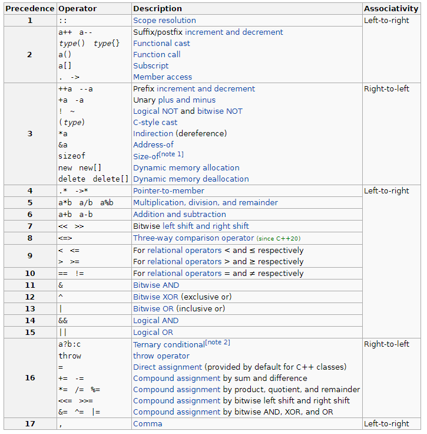

# Типове данни. Основни оператори

### Типове данни

1. Примитивни типове данни

- **bool** -true/false _{0,1}_
- **char** - 'A', '1', _[-128, 127]_
- **int**, **short**, **long**, **long long** - 1,0,-1,
- **double**, **float** - 1.5, 6.7

_usingned_

2. Съставни типове данни

- **Масиви**
- **Класове/Структури**
- **Стринг**

#### Проемнливи

```c++
<data_type> <variable_name>;  // Декларация

<data_type> <variable_name> = <variable_value>; // Декларация + Дефиниция
```

#### Константи

```c++
const char comma = ',';
```

3. Преобразуване на типове данни

- Без загуба на информация: от "по-малък тип към по-голям"

```c++
bool b = true; // true = 1, false = 0
int a = b; // a = 1

short s = 23;
double d = s; // d = 23.0
```

- Със загуба на информация: от "по-голям тип към по-малък"

```c++
int a = 2;
bool b = a; // 1 (при това преобразуване b = 0 <=> a = 0, иначе b = 1)

double d = 23.51;
int i = d; // i = 23 (целочисления тип не пази числото след нулата)
```

### Основни оператори

1. Аритметични оператори

- +, -, /, %, \*, ++, --

2. Оператори за сравнение

- ==, <, >, <=, >=, !=

  3.Логически оператори

- !, &&, ||

4. Оператори за присвояване

- =, +=, -=, \*=, /=, %=

5. Оператор **,**

#### Типове оператори

- Спрямо асоциативността
  - дясно

    ```c++
    a = b = c = 10;
    // 1. c става 10
    // 2. b става равно на c
    // 3. а става равно на b
    ```

  - ляво

    ```c++
    b + c + d
    // 1. Смята b + c
    // 2. Смята k + d
    ```

- Позиция спрямо аргумента
  - префиксен _++a_
  - инфиксен _a + b_
  - суфиксен _a++_

- Приоритет



#### Специфика на логическите оператори **&&** И **||**

_short-circuit evaluation_

```c++
int x = 10;
int y = 5;

x < 5 && y > 4 // x < 5 и дотук ще спре оператора, няма да прочете y > 4
x > 5 || y > 6 // x > 5 и дотук ще спре оператора, няма да прочете y > 6
```

### Вход и изход към конзолата

```c++
std::cout << "Hello, 3 group";
```

```c++
char a;
int b;
std::cin >> a >> b;
std::cout << a << b;
```
